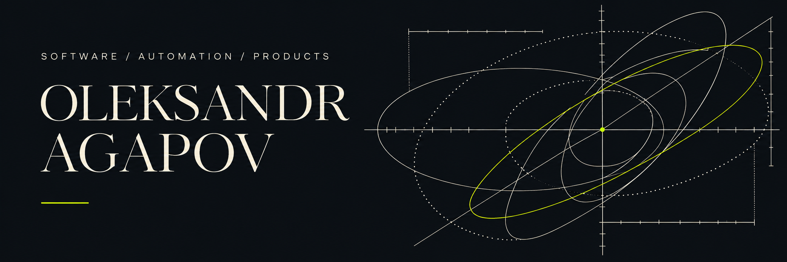

Software Engineering student in Kyiv. I work on software projects and explore automation, data, and product development.

| BUILDING | EXPLORING | WORKING WITH |
| :--- | :--- | :--- |
| Tools and applications for everyday workflows | How technology, data, and product decisions fit together | Python, C# / .NET, APIs, SQL, AI-assisted development |

Kyiv, Ukraine &nbsp; / &nbsp; Taras Shevchenko National University of Kyiv
