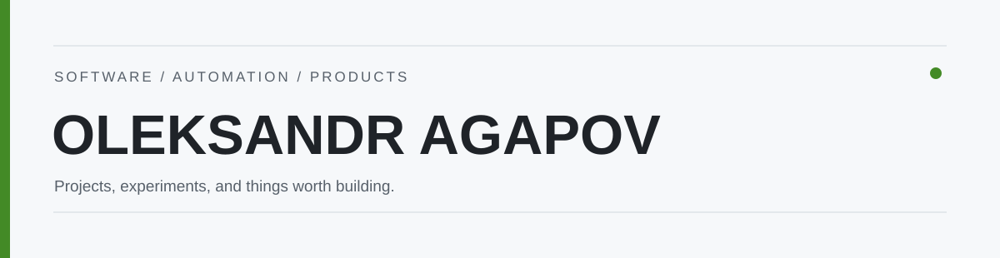

<picture>
  <source media="(prefers-color-scheme: dark)" srcset="assets/header-dark.svg">
  <source media="(prefers-color-scheme: light)" srcset="assets/header-light.svg">
  
</picture>

Software Engineering student interested in products, automation and the systems behind them.

### Building

Software projects and tools for everyday workflows.

### Exploring

How technology, data and product decisions fit together.

### Tools

Python · C# / .NET · APIs · SQL · AI-assisted development

---

Kyiv, Ukraine · Taras Shevchenko National University of Kyiv
